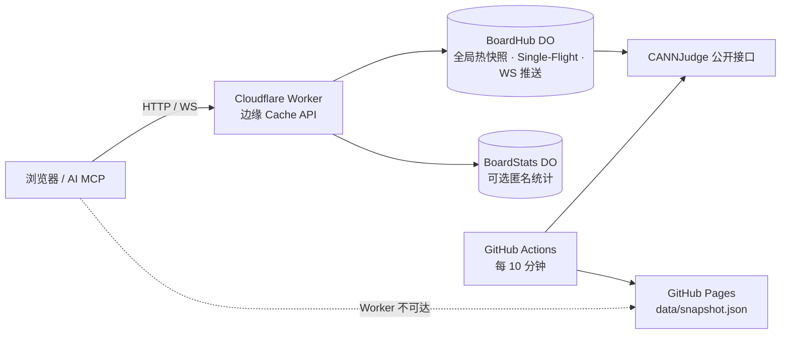

<div align="center">


# ICT 算子赛实时看板

**第十一届华为 ICT 大赛｜昇腾 AI 算子开发赛道（决赛）—— 总榜 10 题轮廓与矩阵、单题 5 公开用例 `tbest` 耗时对比、动态榜首分析与 MCP 查榜**

[](https://zzstar101.github.io/ict-ops-board/)
[](https://ict.nerv-base.com/)
[](https://github.com/zzstar101/ict-ops-board/actions/workflows/pages.yml)
[](LICENSE)

</div>

数据来自 [cannjudge.cn/public/ictcompetition](https://cannjudge.cn/public/ictcompetition) 公开接口，免登录直查全量 800+ 上榜队伍与全部 10 道 Ascend C 算子单题榜：

- **在线看板（GitHub Pages）**：<https://zzstar101.github.io/ict-ops-board/> —— 公开首页，优先接收实时推送；实时服务不可达时自动降级到每 10 分钟构建的静态快照
- **实时直连（Cloudflare Worker）**：<https://ict.nerv-base.com/> —— 边缘缓存 + Durable Object 全局共享热缓存 + WebSocket 实时推送

## 怎么用

| 想看什么 | 怎么做 |
| --- | --- |
| **一眼扫视 10 题强弱** | 默认「总榜总览 · 轮廓视图」每行附带 10 题柱状轮廓（Sparkbar），红色柱即单题第 1；切到「10 题矩阵」可横向展开全部 10 题得分 |
| **查单题 5 个公开用例耗时** | 切到「单题算子榜」，点击 10 道算子任意一题：直接展示 5 个公开用例实测耗时（`μs`）、相对全场最优 `tbest` 的倍率（`≤1.05×` 绿标），以及「公开 5 用例均效率 vs 45 隐藏用例偏差」 |
| **盯住自己的队 / 对手** | 点行首 ☆ 收藏，已关注队伍会置顶到顶部对比条（实时展示总分、榜首奖励、距上一档与榜首分差），仅保存在本地浏览器 |
| **找最划算的提分突破口** | 点击任意队名打开 **10 题提分诊断抽屉**，按「追平/反超榜首可获总分增量（含 `+10×难度` 榜首奖励）」排序 |
| **看十题榜首争夺与碎片度** | 「榜首与提分分析」列出 10 道算子当前 `#1` / `#2` 分差、距满分余量（`100 − #1`）、榜首奖励归属榜与 8–9 题冲刺全通名单 |
| **看刚刚谁刷分 / 谁刷新 `tbest`** | 「近期动态」支持按 1h / 6h / 24h / 7d 与算子筛选；实时流自动区分「真实提交」「榜首易主」与「`tbest` 破纪录触发全场重算」，过滤被动掉分噪音 |
| **导出表格 / 分享视图** | 点击「CSV」导出 UTF-8 表格（Excel 直接打开不乱码）；地址栏即当前视图与弹窗状态，可直接复制分享 |

## 计分规则与动态 `tbest` 说明

- **总分公式**：
  $$\text{总分} = \sum_{i=1}^{10} (\text{难度系数}_i \times \text{单题得分}_i) + \sum_{i:\,\text{rank}_i = 1} (\text{难度系数}_i \times 10)$$
  当前 10 题难度分布：`×1`（1 题）、`×2`（5 题）、`×3`（4 题），总权重 `23` + 榜首奖励池 `230`。
- **动态 `tbest` 重算**：每道算子的 50 个用例（5 公开 + 45 隐藏）按各自全场最优耗时 `tbest` 动态计分——只要有队伍刷新任一用例的 `tbest`，同题所有队伍分数都会随之重算；因此优化出更快的 `tbest` 具备「自己涨分 + 压低对手分」的双向收益。

## 用 AI 读榜（MCP）

提供公开只读、免 API Key 的 **Streamable HTTP MCP** 接口（接入文档位于 `/mcp`）：

- 端点：`https://ict.nerv-base.com/api/mcp`（若遇自定义域 WAF 拦截非浏览器 UA，可使用直连端点 `https://ict-ops-board.zzstarwork.workers.dev/api/mcp`）
- Claude Code 一行接入：
  ```bash
  claude mcp add --transport http ict-ops-board https://ict-ops-board.zzstarwork.workers.dev/api/mcp
  ```
- 提供 5 个只读工具：`ict_list_boards`、`ict_query_leaderboard`、`ict_get_team`、`ict_analyze_cutoff`、`ict_analyze_problem`。

## 架构与缓存设计



- **四层缓存**：Isolate 内存 TTL + 并发合并 + `stale-while-error` → Cloudflare 边缘 `caches.default`（30s 新鲜 / 300s SWR）→ 全局 Durable Object `BoardHub` 持久化 gzip 快照 + Single-Flight 防击穿 → GitHub Pages 每 10 分钟静态快照兜底。

## 本地运行与自部署

```bash
bun install
bun run dev            # 本地开发 → http://127.0.0.1:8792
bun test               # 单元测试 + API/MCP 集成测试
bun run typecheck      # TypeScript 严格检查（含 Worker 类型）
bun run build          # 打包前端静态资源 → dist/client
bun run build:pages    # 打包 Pages + 抓取最新线上快照 → dist/pages
bun run worker:deploy  # 部署到 Cloudflare Worker
```

### 环境变量

| 变量 | 说明 | 默认值 |
| --- | --- | --- |
| `PORT` / `HOST` | 本地服务端口与地址 | `8792` / `127.0.0.1` |
| `CONTEST_SLUG` | CANNJudge 公开赛事 slug | `ictcompetition` |
| `CONTEST_ID` | CANNJudge 赛事 ObjectId | `6a9e2d04bf41025d60f21804` |
| `CACHE_TTL_MS` | 上游缓存 TTL（毫秒） | `25000` |
| `PUSH_INTERVAL_MS` | WebSocket 推送间隔（毫秒） | `30000` |
| `LIVE_ORIGIN` | GitHub Pages 优先连接的 Worker 地址 | `https://ict.nerv-base.com` |
| `STATS_KEY` | 可选：开启 `/stats` 匿名统计后台的密钥 | 未开启 |

---

<div align="center"><sub>以 <a href="LICENSE">MIT</a> 协议开源 · 数据来自 <a href="https://cannjudge.cn/public/ictcompetition">CANNJudge</a> 公开榜单接口。</sub></div>
